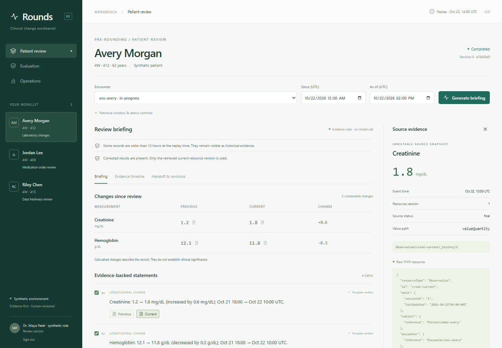

# Rounds — Clinical Change Intelligence Workbench

An evidence-first clinical AI engineering demonstration: review what changed within a patient encounter, inspect exact FHIR source versions, and accept a clinician-reviewed handoff.

V2 adds a React/TypeScript workspace, FastAPI service, durable jobs, reproducible evidence snapshots, deterministic change calculations, optional LLM prioritization, review revisions, evaluation reports, and operational telemetry. The original Streamlit prototype remains available.



**Use synthetic data for the demonstration.** The implemented controls demonstrate engineering behavior; they do not establish clinical validity, regulatory approval, or deployment readiness for real patient care.

## Run v2

Requirements: Python 3.11+, [uv](https://docs.astral.sh/uv/), and Node.js 22.14+.

```powershell
uv sync --frozen --extra dev
npm --prefix web ci
npm --prefix web run build
uv run python scripts/run_workbench.py serve
```

Open [localhost:8000](http://localhost:8000) and choose **Open synthetic workspace**. The default demo uses SQLite and bundled synthetic FHIR resources, with no Docker, hosted-model call, or API key required.

If port 8000 is occupied, match the configured public origin to your chosen port:

```powershell
$env:WORKBENCH_PUBLIC_URL = "http://localhost:8012"
uv run python scripts/run_workbench.py serve --port 8012
```

Configuration is loaded from the repository's `.env`, with process environment variables taking precedence. See [.env.example](.env.example). The v2 database uses `WORKBENCH_DATABASE_URL`; the v1 `DATABASE_URL` is separate. V2 demo mode migrates its own schema on startup.

## Demonstration workflow

1. Select **Avery Morgan** and generate a briefing. Review two exact lab deltas and the corrected-result warning.
2. Open **Previous**, **Current**, or **Source** beside a statement to inspect the saved FHIR JSON, resource version, value path, and SHA-256 fingerprint.
3. Open **Handoff & revisions**, add a clinician note, save a draft, and accept the handoff. Every revision records the reviewer, selected claims, and evidence snapshot hash.
4. Select **Jordan Lee**, open the demo controls, and simulate an observation outage or access denial. The briefing is withheld and the manifest distinguishes unavailable, denied, empty, and unqueried sources.
5. Select **Riley Chen** to inspect stale evidence and unknown event timestamps.
6. Open **Evaluation** for versioned synthetic scenarios, then **Operations** for run status, processing latency, token use, estimated cost, and access/review events.

The fixed replay clock is October 22, 2026, 14:00 UTC. Window controls are explicitly UTC; the demo stays reproducible as the real date changes. Completed runs and review revisions survive process restarts and can be reopened from Recent briefings.

## What the AI does

Code normalizes evidence, computes compatible changes, and renders factual claims. The optional model prioritizes those claims by returning an ordered list of their opaque IDs. It cannot rewrite clinical values or introduce new claims; invalid, omitted, duplicated, refused, or truncated rankings fall back to the complete deterministic briefing.

To enable hosted ranking, set:

```ini
WORKBENCH_HOSTED_LLM=true
OPENAI_API_KEY=your-key
WORKBENCH_MODEL=gpt-4o-mini
```

The ranking request includes controlled measurement labels, opaque claim IDs, claim types, and relative timing. It excludes raw FHIR JSON, free-text source labels, patient names/IDs, resource IDs, and absolute dates. This is data minimization, not a general de-identification certification. Assess the deployment boundary before connecting real records.

Optional `WORKBENCH_INPUT_USD_PER_MILLION` and `WORKBENCH_OUTPUT_USD_PER_MILLION` values enable estimated model cost. Prices are operator-supplied; provider billing and hosting costs are not inferred.

## Verification

```powershell
uv run pytest -q
uv run ruff check src/workbench tests/test_workbench*.py
uv run python scripts/run_workbench.py evaluate --output output/evaluation.json
```

On PowerShell, if a tool does not expand the test wildcard, pass the specific filenames or use `uv run ruff check src/workbench`.

The evaluation command exits nonzero when an expected fixture fails. Compare versioned report artifacts with `--baseline output/baseline.json`. Reports expose metric numerators, denominators, fixture expectations, versions, and limitations. The bundled cases test engineering properties, not medical accuracy or LLM prioritization quality.

The test suite covers the v1 regression checks and v2 retrieval boundaries, exact quantities, source tampering, missingness, idempotency, cancellation, worker recovery, review conflicts, authorization, model fallback, SMART state/PKCE, and retention. The PostgreSQL integration check requires a disposable `WORKBENCH_TEST_POSTGRES_URL` ending in `_test`; CI supplies it.

## Deploy the synthetic demo

```powershell
docker compose -f compose.v2.yml up --build -d
```

This starts PostgreSQL, a non-root API/web container, and a separate durable-job worker. Ports bind to localhost. The sample credentials are for local synthetic use. Python and frontend dependencies are locked in `uv.lock` and `web/package-lock.json`.

See [deployment and operations](docs/operations.md) for migrations, worker settings, retention, backup/rollback, and validation limits. Docker configuration validation alone does not confirm a successful container build or PostgreSQL run.

## FHIR and SMART integration

V2 supports scoped service-token API access and a browser-bound SMART sandbox flow with pinned endpoints, PKCE, expiring sessions, encrypted upstream token storage, and patient/encounter context binding. See [SMART setup](docs/smart_on_fhir_setup.md).

SMART actors are identified as authorized launch sessions. Named clinician identity federation, enterprise role management, refresh-token rotation, and multi-organization tenancy remain separate integration work. This repository does not claim HIPAA compliance or clinical production certification.

## Implementation

```text
web/                    React/TypeScript review workspace
src/workbench/
  api.py                Authenticated API and static web serving
  sources.py            Synthetic replay and scoped FHIR adapters
  normalization.py      Typed evidence extraction and provenance
  pipeline.py           Temporal deltas, claim templates, verification
  generation.py         Optional bounded LLM ranking
  persistence.py        Runs, snapshots, revisions, sessions, access events
  worker.py             Durable jobs, leases, recovery, cancellation
  security.py, smart.py  Session and SMART sandbox controls
  evaluation.py         Versioned synthetic evaluation
  maintenance.py        Explicit retention preview/purge
migrations/             Versioned v2 database schema
scripts/run_workbench.py Local entry point
```

See [architecture](docs/architecture.md), [v2 implementation status](docs/v2_status.md), and the [original proposal](docs/v2_proposal.md).

## Original Streamlit prototype

The original pipeline remains in `src/main.py`, with its UI at `src/ui/app.py`. Use `pip install -r requirements.txt`, the original `docker-compose.yml`, `python scripts/init_db.py`, and `python scripts/load_synthea.py`, then run `streamlit run src/ui/app.py`. Its prompt-based citations and regex redaction do not have the v2 verification boundary. Prefer v2 for the evidence/review demonstration.
